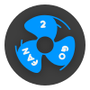
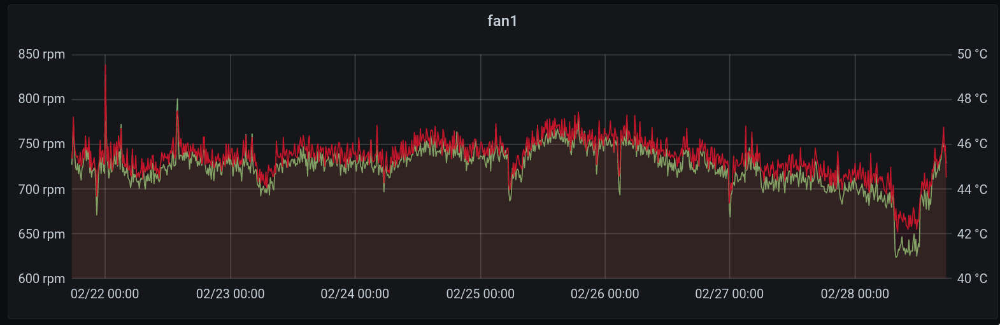

<h1 align="center">
  
  <br>
  fan2go
  <br>
</h1>

<h4 align="center">A daemon to control the fans of your computer.</h4>

<div align="center">

[]()
[](https://github.com/markusressel/fan2go/releases)
[](/LICENSE)

</div>

<p align="center"></p>

# Features

* [x] Intuitive YAML based configuration
* [x] Massive range of supported devices
    * [x] lm-sensors (hwmon) based sensors and fans
    * [x] Fans and temperature sensor on NVIDIA GPUs ([nvml](https://developer.nvidia.com/management-library-nvml))
    * [x] File based fan/sensor for control/measurement of custom devices
    * [x] Command based fan/sensor
* [x] Per fan user-defined speed curves
* [x] Fully customizable and composable curve definitions
* [x] Works after resume from suspend
* [x] **Stable** device paths after reboot
* [x] Automatic analysis of fan properties, like:
    * [x] RPM curve
    * [x] minimum and maximum PWM
* [x] Error notifications
* [x] Prometheus exporter
* [x] (optional) REST Api

# UI

fan2go is first and foremost a daemon that runs in the background. However, it also provides
a small set of CLI commands (see [CLI Commands](#cli-commands)) as well as an optional local HTTP API to allow
external programs to interact with it. This API can be used to create UI clients or other tools.

## UI Clients

[fan2go-tui](https://github.com/markusressel/fan2go-tui) - (Official) Terminal UI for fan2go.

[](https://asciinema.org/a/1099673)

# How to use

fan2go relies on [lm-sensors](https://github.com/lm-sensors/lm-sensors) to get both temperature and RPM sensor readings,
as well as PWM controls, so you will have
to [set it up first](https://wiki.archlinux.org/index.php/Lm_sensors#Installation).

## Installation

### Arch Linux 

Stable releases:

```shell
yay -S fan2go
```

Development version, built from the latest `master`. It contains unreleased changes, including breaking ones:

```shell
yay -S fan2go-git
```

Both packages print upgrade notes when an update contains breaking changes. The full notes for every version are on
the [releases page](https://github.com/markusressel/fan2go/releases).

<details>
<summary>Community Maintained Packages</summary>

### Nix OS 

- Nix with [Flakes](https://nixos.wiki/wiki/Flakes):

```shell
nix profile install nixpkgs#fan2go
```

- Nix stable:

```shell
nix-env -f '<nixpkgs>' -iA fan2go
```

### Debian / Ubuntu

See: https://github.com/johnwbyrd/fan2go-package/

</details>

### Manual

Download the latest release from GitHub:

```shell
# Install dependencies
sudo pacman -S libnotify

curl -L -o fan2go https://github.com/markusressel/fan2go/releases/latest/download/fan2go-linux-amd64
chmod +x fan2go
sudo cp ./fan2go /usr/bin/fan2go
fan2go -h
```

Or compile yourself:

```shell
git clone https://github.com/markusressel/fan2go.git
cd fan2go
make build
sudo cp ./bin/fan2go /usr/bin/fan2go
sudo chmod ug+x /usr/bin/fan2go
```

## Configuration

Then configure fan2go by creating a YAML configuration file in **one** of the following locations:

* `/etc/fan2go/fan2go.yaml` (recommended)
* `/root/.fan2go/fan2go.yaml`
* `./fan2go.yaml`

```shell
sudo mkdir /etc/fan2go
sudo nano /etc/fan2go/fan2go.yaml
```

The most important configuration options you need to define are the `fans:`, `sensors:` and `curves:` sections.

### Fans

Under `fans:` you need to define a list of fan devices that you want to control using fan2go. To detect fans on your
system run `fan2go detect`, which will print a list of devices exposed by the hwmon filesystem backend:

```shell
$ fan2go detect
=========== hwmon: ============

> Platform: nct6798-isa-0290
 Fans     Index  Channel  Label        RPM   PWM  Mode
          1      1        hwmon4/fan1  0     153  Manual
          2      2        hwmon4/fan2  1223  104  Manual
          3      3        hwmon4/fan3  677   107  Manual
 Sensors   Index   Label    Value
           1       SYSTIN   41000
           2       CPUTIN   64000

> Platform: amdgpu-pci-0031
 Fans     Index  Channel  Label        RPM   PWM  Mode
          1      1        hwmon8/fan1  561   43   Manual
 Sensors   Index   Label      Value
           1       edge       58000
           2       junction   61000
           3       mem        56000

=========== nvidia: ===========

> Device: nvidia-10DE2489-0800
  Fans     Index  Label  PWM  RPM   Mode
           1      Fan 1  36   1300  Auto
           2      Fan 2  36   1298  Auto
  Sensors  Index  Label        Value
           1      Temperature  59000
```

The `hwmon` fan index is based on device enumeration and is not stable for a given fan if hardware configuration
changes.
The Linux kernel hwmon channel is a better identifier for configuration as it is largely based on the fan headers
in use.

Fan RPM, PWM, and temperature sensors are independent and Linux does not associate them automatically. A given PWM
may control more than one fan, and a fan may not be under the control of a PWM. By default, fan2go guesses and sets
the pwm channel number for a given fan to the fan's RPM sensor channel. You can override this in the config.

For `nvidia` devices, the fan index *is* stable.

Note that it can happen that the hardware only gives limited control over a fan and it, for example,
always runs with at least 30% speed - even if in automatic mode the hardware may make it stop entirely
if the temperature is low enough.

#### HwMon

To use detected hwmon devices in your configuration, use the `hwmon` fan type:

```yaml
# A list of fans to control
fans:
  # A user defined ID.
  # Used for logging only
  - id: cpu
    # The type of fan configuration, one of: hwmon | file
    hwmon:
      # A regex matching a controller platform displayed by `fan2go detect`, f.ex.:
      # "nouveau", "coretemp", "it8620", "corsaircpro-.*" etc.
      # The chip name printed by `sensors` (lm-sensors) works too, see "Platform names" below.
      platform: nct6798
      # The channel of this fan's RPM sensor as displayed by `fan2go detect`
      rpmChannel: 1
      # The pwm channel that controls this fan; fan2go defaults to same channel number as fan RPM
      pwmChannel: 1
    # Indicates whether this fan should never stop rotating, regardless of
    # how low the curve value is
    neverStop: true
    # The curve ID that should be used to determine the
    # speed of this fan
    curve: cpu_curve
```

##### Platform names

`platform` is matched against the platform name shown by `fan2go detect` and, if no fan (or sensor) matches that
way, against the chip name printed by `sensors` (lm-sensors). For most chips both names are identical. They differ
e.g. for PCI devices with an address of `0x1000` or higher: `fan2go detect` shows `nvme-pci-05a00` while `sensors`
prints `nvme-pci-5a00`. In that case `fan2go detect` shows both:

```shell
> Platform: nvme-pci-05a00 (sensors: nvme-pci-5a00)
```

Since `platform` is a regex that only has to match a part of the name, `nvme-pci-5a00` doesn't match
`nvme-pci-05a00`, but it does match the `sensors` name, so both work.

#### NVIDIA

To use detected NVIDIA GPUs in your configuration, use the `nvidia` fan type:

```yaml
fans:
  - id: gpufan1
    nvidia:
      # A regex matching a nvidia device as displayed by `fan2go detect`, must not be empty.
      # the following matches all nvidia devices in your system
      # (good enough if you only have one), otherwise you could
      # also use nvidia-10DE2489-0800 or similar
      device: nvidia
      # The fan's index as shown by `fan2go detect`
      index: 1
    curve: gpu_curve

  # same for the second fan
  - id: gpufan2
    nvidia:
      device: nvidia
      index: 2
    curve: gpu_curve
```

Note that the fan speed can only be controlled for GPUs of the "Maxwell" generation
(Geforce 9xx) and newer, and that reading the fan speed in RPM requires nvidia driver 565
or newer.

#### File

```yaml
fans:
  - id: file_fan
    file:
      # Path to a file to get/set the PWM target for this fan
      path: /tmp/file_fan
      # Path to a file to read the current RPM value of this fan
      rpmPath: /tmp/file_fan_rpm
```

```shell
> cat /tmp/file_fan
255
> cat /tmp/file_fan_rpm
3421
```

#### CMD

Please also make sure to read the section about
[considerations for using the cmd sensor/fan](#using-external-commands-for-sensorsfans).

```yaml
fans:
  - id: cmd_fan
    cmd:
      # Command to apply a new PWM value (0..255)
      # Use "%pwm%" to specify where the target pwm value should be used within the arguments
      setPwm:
        exec: /usr/bin/some-program
        args: [ "--set", "%pwm%" ]
        # (optional) maximum time the command may run before it is killed and treated as failed,
        # default: 2s (available for setPwm, getPwm and getRpm).
        # Use a unit: like for other durations, a plain number means milliseconds.
        timeout: 2s
      # (optional) Command to retrieve the current PWM value (0..255).
      # Without it, fan2go can't read the original PWM value, and leaves the fan
      # at the last speed it set when it exits (see controlMode.onExit to change that).
      getPwm:
        exec: /usr/bin/nvidia-settings
        args: [ "-a", "someargument" ]
      # (optional) Command to retrieve the current RPM value
      getRpm:
        exec: /usr/bin/nvidia-settings
        args: [ "-a", "someargument" ]
```

#### Disk

Reads the temperature of a block device (SATA, NVMe, etc.) using a stable device path instead of an
hwmon platform index that can change across reboots.

```yaml
sensors:
  - id: ssd_temp
    disk:
      # Full path (recommended for clarity)
      device: /dev/disk/by-id/ata-Samsung_SSD_870_EVO_1TB_S1234567890
      # Short form also accepted (prefix /dev/disk/by-id/ is auto-applied):
      # device: ata-Samsung_SSD_870_EVO_1TB_S1234567890
      # The /dev/ prefix is also optional (e.g. just "sda"):
      # device: sda

  - id: nvme_temp
    disk:
      device: /dev/disk/by-id/nvme-Samsung_SSD_980_1TB_S1234567890
      # Short form: device: nvme-Samsung_SSD_980_1TB_S1234567890
```

Requires the `drivetemp` kernel module for SATA drives (standard since kernel 5.6) or `nvme-hwmon`
for NVMe (standard since kernel 4.15). Falls back to a direct ATA SMART ioctl for SATA drives
without `drivetemp` loaded.

#### Advanced Options

If the automatic fan curve analysis doesn't provide a good enough estimation
for how the fan behaves, you can use the following configuration options (per fan definition)
to correct it:

```yaml
fans:
  - id: ...
    ...
    # (Optional) Override for the lowest PWM value at which the
    # fan is able to maintain rotation if it was spinning previously.
    minPwm: 30
    # (Optional) Override for the lowest PWM value at which the
    # fan will still be able to start rotating.
    # Note: Settings this to a value that is too small
    #       may damage your fans. Use at your own risk!
    startPwm: 30
    # (Optional) Override for the highest PWM value which still yields
    # an increased rotational speed compared to lower values.
    # Note: you can also use this to limit the max speed of a fan.
    maxPwm: 255
    # Note: minPwm, startPwm and maxPwm must be in [0..255], and minPwm and startPwm
    #       must not be greater than maxPwm. minPwm > startPwm only causes a warning.
    # (Optional) Override the global fanController.pwmSetDelay for this specific fan.
    # Useful when a fan requires more or less time to respond to PWM changes than the global default.
    # pwmSetDelay: 10ms
    # (Optional) What to do with this fan while its curve can't be evaluated, e.g. because a sensor
    # can't be read or its value is stale. See "Sensor failures" below.
    #   max (default): set the fan to its maxPwm
    #   restore:       hand the fan back like on exit (see controlMode.onExit); maxPwm if that would
    #                  leave the fan at a fixed PWM value
    onSensorFailure: max
    # (Optional) Configure how fan2go maps the internal [0..255] PWM range to
    # hardware-specific PWM values. If omitted, fan2go auto-detects the mapping
    # during fan initialization.
    #
    # Modes:
    #
    # autodetect (default): auto-detect the PWM map during fan initialization.
    pwmMap: autodetect
    #
    # identity: assume a 1:1 mapping (0→0, 1→1, ..., 255→255).
    # Use this if your fan supports the full PWM range and you want to skip
    # the initialization measurement.
    # pwmMap: identity
    #
    # linear: linearly interpolate between user-specified control points.
    # Useful when you know the endpoints (or intermediate points) but want
    # smooth values in between.
    # Note: keys and values must be in [0..255], values must be strictly monotonically increasing.
    # pwmMap:
    #   linear:
    #     0: 0
    #     255: 255
    #
    # values: step-interpolate user-specified control points.
    # Use for fans that only support a limited set of discrete PWM values
    # (e.g. off / low / medium / high).
    # Note: keys and values must be in [0..255], values must be strictly monotonically increasing.
    # pwmMap:
    #   values:
    #     0: 0
    #     64: 128
    #     192: 255
    # (Optional) Configure how fan2go determines the mapping from a PWM value it sets
    # to the value the fan hardware reports back. Some fans do not echo the exact value
    # written due to hardware or driver quirks. If omitted, fan2go auto-detects this
    # during fan initialization.
    #
    # Modes:
    #
    # autodetect (default): sweep all PWM values and record what the fan reports back.
    setPwmToGetPwmMap: autodetect
    #
    # identity: assume the fan reports back exactly what was set (1:1 mapping).
    # Equivalent to the --assume-pwm-map-identity flag on `fan2go fan init`.
    # setPwmToGetPwmMap: identity
    #
    # linear: linearly interpolate between user-specified control points.
    # setPwmToGetPwmMap:
    #   linear:
    #     0: 0
    #     255: 255
    #
    # values: step-interpolate user-specified control points.
    # setPwmToGetPwmMap:
    #   values:
    #     0: 0
    #     128: 128
    #     255: 255
    # (Optional) Configure the control mode fan2go uses while running and on exit.
    # Both fields are optional; omitting controlMode entirely preserves existing behavior.
    #
    # active: the control mode to set when fan2go takes control of this fan.
    #   Accepts: "pwm" (default, with "disabled" fallback), "disabled", "auto", or an integer.
    #   On hwmon fans, integers >= 3 are written to pwmX_enable as is (e.g. a driver specific mode like 5);
    #   0, 1 and 2 mean disabled, pwm and auto. Nvidia fans don't support integers >= 3.
    # onExit: what to do when fan2go exits.
    #   This also applies when a fan controller stops because of an error, and to onSensorFailure: restore.
    #   Further SIGINT/SIGTERM/SIGHUP
    #   signals during shutdown are ignored until all fans are handled; use SIGKILL to force an exit.
    #   String shorthand:
    #     onExit: restore   # restore original control mode and PWM value (default).
    #                       # Values fan2go could not read when it started (e.g. a cmd fan without
    #                       # getPwm) are not restored: the fan stays at the last speed set by fan2go.
    #                       # If the original control mode is unknown, but fan2go can set it, the
    #                       # fan is switched to automatic control instead. Only if that fails, it
    #                       # is set back to its original PWM value (if known) in manual mode.
    #     onExit: none      # leave fan at last speed set by fan2go (useful for hardware controllers
    #                       # that remember PWM settings — see issue #416)
    #   Map form (set explicit values on exit):
    #     onExit:
    #       mode: auto      # set a specific control mode on exit
    #       speed: 128      # set a fixed speed on exit (0..255). It is mapped through the
    #                       # pwmMap of the fan (not scaled to minPwm..maxPwm) before it is written.
    #     # mode and speed can be combined or used independently.
    controlMode:
      active: pwm
      onExit: restore
    # By default (useUnscaledCurveValues: false) speed values from the curve are scaled
    # from 1..255 (or 1%..100%) to MinPwm..MaxPwm  and speed values < 1(%) are set to 0,
    # before they're mapped with pwmMap (the value looked up in pwmMap is then used to
    # actually set the speed in the fan's controlling device).
    # If useUnscaledCurveValues is set to true, the values from the curve for a specific temperature
    # are directly mapped with PwmMap, *without* scaling them first.
    # Note: If neverStop is also set to true, values smaller than MinPwm (including 0) are replaced with
    #   MinPwm, otherwise values smaller than MinPwm are replaced with 0 (the fan wouldn't turn anyway).
    #   But all values >= MinPwm are used as is if this option is set to true.
    useUnscaledCurveValues: true
    # (Optional) Configuration options for sanity checks
    sanityCheck:
      # (Optional) Control the behavior of the "pwmValueChangedByThirdParty" sanity check
      # This check is used to detect if the PWM value of a fan has changed between two consecutive
      # control loop cycles, which is usually an indication that an external program is trying to control the fan
      # at the same time as fan2go. This can lead to unexpected behavior and is usually not desired, so 
      # fan2go will log a warning if this happens.
      pwmValueChangedByThirdParty:
        # (Optional) Whether to enable this check or not
        enabled: true
      # (Optional) Control the behavior of the "fanModeChangedByThirdParty" sanity check
      # This check is used to detect if the fan mode (automatic/manual) has changed between two consecutive
      # control loop cycles, which is usually an indication that an external program is trying to control the fan
      # at the same time as fan2go. This can lead to unexpected behavior and is usually not desired, so
      # fan2go will reset the desired fan mode and log a warning if this happens.
      fanModeChangedByThirdParty:
        # (Optional) Whether to enable this check or not
        enabled: true
        # (Optional) Throttle duration for the execution of this check.
        throttleDuration: 10s
```

### Sensors

Under `sensors:` you need to define a list of temperature sensor devices that you want to monitor and use to adjust
fanspeeds. Like with fans, you can find usable devices using `fan2go detect`.

#### HwMon

```yaml
# A list of sensors to monitor
sensors:
  # A user defined ID, which is used to reference
  # a sensor in a curve configuration (see below)
  - id: cpu_package
    # The type of sensor configuration, one of: hwmon | nvidia | file | cmd | disk
    hwmon:
      # A regex matching a controller platform displayed by `fan2go detect`, f.ex.:
      # "coretemp", "it8620", "corsaircpro-*" etc.
      # The chip name printed by `sensors` (lm-sensors) works too, see "Platform names" in the fan section.
      platform: coretemp
      # The index of this sensor as displayed by `fan2go detect`
      index: 1
```

#### NVIDIA

```yaml
sensors:
  - id: gpu_temp
    nvidia:
      # A regex matching a nvidia device as displayed by `fan2go detect`, must not be empty
      device: nvidia-10DE2489-0800
      # The index of this sensor as displayed by `fan2go detect`
      # (currently NVIDIA/nvml exposes only a single temperature sensor per GPU)
      index: 1
```

#### File

```yaml
sensors:
  - id: file_sensor
    file:
      # Path to the file containing sensor values
      path: /tmp/file_sensor
```

The file contains a value in milli-units, like f.ex. milli-degrees.

```bash
> cat /tmp/file_sensor
10000
```

#### CMD

Please also make sure to read the section about
[considerations for using the cmd sensor/fan](#using-external-commands-for-sensorsfans).

Just like the `file` sensor, the command must output the sensor value in milli-units,
like f.ex. milli-degrees.

```yaml
sensors:
  - id: cmd_fan
    cmd:
      # Path to the executable to run to retrieve the current sensor value
      exec: /usr/bin/bash
      # (optional) arguments to pass to the executable
      args: [ '/home/markus/myscript.sh' ]
      # (optional) maximum time the command may run before it is killed and treated as failed, default: 2s.
      # Use a unit: like for other durations, a plain number means milliseconds.
      timeout: 2s
```

### Curves

Under `curves:` you need to define a list of fan speed curves, which represent the speed of a fan based on one or more
temperature sensors.

> **Speed values:** Curve values range from `0` to `255` (equivalently `0%` to `100%`).
> By default, fan2go scales these to the fan's detected (or configured) `minPwm`..`maxPwm` range:
> - `0` / `0%` → fan off (unless `neverStop: true`, in which case the fan is held at `minPwm`)
> - `1`..`255` / `1%`..`100%` → linearly mapped to `minPwm`..`maxPwm`
>
> To use curve values as raw PWM values without scaling, set `useUnscaledCurveValues: true` in the fan config.

#### Linear

To create a linear speed curve, use a curve of type `linear`.

This curve type can be used with a min/max sensor value, where the min temp will result in a curve value of `0` and the
max temp will result in a curve value of `255`:

```yaml
curves:
  - id: cpu_curve
    # The type of the curve, one of: linear | function
    linear:
      # The sensor ID to use as a temperature input
      sensor: cpu_package
      # Sensor input value (in degrees Celsius)
      # at which the curve is at minimum speed
      min: 40
      # Sensor input value at which the curve is at maximum speed
      max: 80
```

You can also define the curve in multiple, linear sections using the `steps` parameter,
where the left side refers to the sensor input value and the right side refers to the curve value at that sensor input.

```yaml
curves:
  - id: cpu_curve
    # The type of the curve
    linear:
      # The sensor ID to use as a temperature input
      sensor: cpu_package
      # Steps to define a section-wise defined speed curve function.
      steps:
        # Sensor value (in degrees Celsius) -> Speed
        - 40: 0%   #   0% and speed value 0 are the same
        - 41: 1%   #   1% and speed value 1 are the same and mean "run at minimum speed" (MinPwm)
          # Note: between 41 and 50°C the fan speed will be interpolated between 1% and 20%
        - 50: 20%  #  20% is equivalent to speed value ≈ 50
          # Note: between 50 and 80°C the fan speed will be interpolated between 20% and 100%
          #       for example, at 65°C it'll run at 60% speed
        - 80: 100% # 100% is equivalent to speed value 255
```

> NOTE: When using `useUnscaledCurveValues` in the fan configuration, the values specified in the curve are **not scaled
**
> to the [MinPwm..MaxPwm] range of the fan, but are directly mapped with the `pwmMap` (if specified) or used as is (if
> no `pwmMap` is specified and a 1:1 mapping is assumed).
> In this case, it is recommended to specify curve values in the same range as the expected PWM values after scaling to
> avoid confusion.
> So if your fan has a MinPwm of 30 and a MaxPwm of 255, you should specify curve values in the [30..255] range.

Alternatively the speeds can be specified in [0..255] range:

```yaml
curves:
  - id: cpu_curve
    # The type of the curve
    linear:
      # The sensor ID to use as a temperature input
      sensor: cpu_package
      # Steps to define a section-wise defined speed curve function.
      steps:
        # Sensor value (in degrees Celsius) -> Speed (0-255)
        - 40: 0
        - 41: 1
        - 50: 50
        - 80: 255
```

#### Staircase

To create a staircase speed curve, use a curve of type `staircase`.

It maintains static fan speeds at defined temperature ranges.
This prevents fans from constantly ramping up and down (oscillating) in response to minor,
rapid fluctuations in sensor temperature, offering a more consistent acoustic profile.

```yaml
curves:
  - id: staircase_curve
    staircase:
      sensor: cpu_package
      hysteresis:
        down: 6
      steps:
        # Sensor value (in degrees Celsius) -> Speed (0-255)
        - 40: 1
        - 50: 50
        - 80: 255
```

#### PID

If you want to get your hands dirty and use a PID based curve, you can use `pid`:

```yaml
curves:
  - id: pid_curve
    pid:
      sensor: cpu_package
      setPoint: 60
      p: -0.05
      i: -0.005
      d: -0.005
```

Unlike the other curve types, this one does not use the average of the sensor data
to calculate its value, which allows you to create a completely custom behaviour.
It uses the last successful (raw) reading of the sensor monitor, which is at most one
`tempSensorPollingRate` old, and only advances when a new reading has arrived, using the time
between two readings for its I and D terms. Evaluating the curve more often than the sensor is
polled therefore doesn't change its result. The curve is evaluated once per [cycle](#cycle), even if
several fans (or `function` curves) use it.
Keep in mind though that the fan controller may also be PID based (depending on the
specified `controlAlgorithm`) which would also affect how the curve is applied to the fan.

`setPoint` is the target temperature.

See: [PID controller on Wikipedia](https://en.wikipedia.org/wiki/Proportional%E2%80%93integral%E2%80%93derivative_controller)
for more information on what a PID controller is.

#### Function

To create more complex curves you can combine existing curves using a curve of type `function`:

```yaml
curves:
  - id: case_avg_curve
    function:
      # Type of aggregation function to use, one of: minimum | maximum | average | delta | sum | difference
      type: average
      # A list of curve IDs to use
      curves:
        - cpu_curve
        - mainboard_curve
        - ssd_curve
```

### Example

An example configuration file including more detailed documentation can be found in [fan2go.yaml](/fan2go.yaml).

### Verify your Configuration

To check whether your configuration is correct before actually running fan2go you can use:

```shell
> sudo fan2go config validate
 INFO  Using configuration file at: /etc/fan2go/fan2go.yaml
 SUCCESS  Config looks good! :)
```

or to validate a specific config file:

```shell
> fan2go -c "./my_config.yaml" config validate
 INFO  Using configuration file at: ./my_config.yaml
 WARNING  Unused curve configuration: m2_first_ssd_curve
  ERROR   Validation failed: Curve m2_ssd_curve: no curve definition with id 'm2_first_ssd_curve123' found
```

## Using external commands for sensors/fans

fan2go supports using external executables for use as both sensor input, as well as fan output (and rpm input). There
are some considerations you should take into account before using this feature though:

### Security

Since fan2go requires root permissions to interact with lm-sensors, executables run by fan2go are also executed as root.
To prevent some malicious actor from taking advantage of this fan2go will only allow the execution of files that only
allow the root user (UID 0) to modify the file.

### Side effects

Running external commands repeatedly through fan2go can have unintended side effects. F.ex., on a laptop using hybrid
graphics, running `nvidia-settings` can cause the dedicated GPU to wake up, resulting in substantial increase in power
consumption while on battery. Also, fan2go expects to be able to update sensor values with a minimal delay, so using a
long running script or some network call with a long timeout could also cause problems. Each command is killed and
treated as failed after its `timeout` (default: 2s). Each command runs in its own process group: on timeout, the whole
process group is killed, including processes the command started in the background. A command that starts a
long-running background process (e.g. a daemon) and exits in time is not killed. If the background process keeps the
command's output open, fan2go uses the output shortly after the command itself has exited and closes its end of it, so
the background process should redirect its output (e.g. to `/dev/null`). With great power comes great responsibility, always
remember that :)

## Run

After successfully verifying your configuration you can launch fan2go from the CLI and make sure the initial setup is
working as expected. Assuming you put your configuration file in `/etc/fan2go/fan2go.yaml` run:

```shell
> fan2go help
fan2go is a simple daemon that controls the fans
on your computer based on temperature sensors.

Usage:
  fan2go [flags]
  fan2go [command]

Available Commands:
  completion  Generate the autocompletion script for the specified shell
  config      Configuration related commands
  curve       Curve related commands
  detect      Detect fans and sensors
  fan         Fan related commands
  help        Help about any command
  sensor      Sensor related commands
  version     Print the version number of fan2go

Flags:
  -c, --config string   config file (default is $HOME/.fan2go.yaml)
  -h, --help            help for fan2go
      --no-color        Disable all terminal output coloration
      --no-style        Disable all terminal output styling
  -v, --verbose         More verbose output

Use "fan2go [command] --help" for more information about a command.
> sudo fan2go
```

Alternatively you can specify the path to your configuration file like this:

```shell
> sudo fan2go -c /home/markus/my_fan2go_config.yaml
```

## As a Service

### Systemd

When installing fan2go using a package, it comes with a [systemd unit file](./fan2go.service). To enable it simply run:

```shell
sudo systemctl daemon-reload
sudo systemctl enable --now fan2go
# follow logs
journalctl -u fan2go -f
```

> NOTE: If you want to use a config path that differs from the default one, make sure to edit the
> unit file and point the `-c` flag to the correct path.

## CLI Commands

Although fan2go is a fan controller daemon at heart, it also provides some handy cli commands to interact with the
devices that you have specified within your config.

### Fans interaction

```shell
> fan2go fan --id cpu speed 100

> fan2go fan --id cpu speed
255

> fan2go fan --id cpu rpm
546

> fan2go fan --id cpu mode
No control, 100% all the time (0)

> fan2go fan --id cpu mode auto
Automatic control by integrated hardware (2)
```

### Sensors

```shell
> fan2go sensor --id cpu_package
46000
```

### Print fan curve data

For each newly configured fan **fan2go** measures its fan curve and stores it in a db for future reference. You can take
a look at this measurement using the following command:

```shell
> sudo fan2go fan --id cpu curve 
cpu
                
  Min PWM    30 
  Start PWM  30 
  Max PWM    255

No fan curve data yet...

> sudo fan2go fan --id in_front curve 
nct6798 -> pwm2

  Min PWM     0 
  Start PWM   0
  Max PWM     194

 1994 ┤                                                                          ╭────────────────────────
 1900 ┤                                                                       ╭──╯
 1805 ┤                                                                  ╭────╯
 1711 ┤                                                             ╭────╯
 1616 ┤                                                        ╭────╯
 1522 ┤                                                    ╭───╯
 1427 ┤                                               ╭────╯
 1333 ┤                                          ╭────╯
 1238 ┤                                    ╭─────╯
 1144 ┤                               ╭────╯
 1049 ┤                         ╭─────╯
  955 ┤                   ╭─────╯
  860 ┤             ╭─────╯
  766 ┤       ╭─────╯
  671 ┤ ╭─────╯
  577 ┼─╯
                                                    RPM / PWM
```

## Statistics

fan2go has a prometheus exporter built in, which you can use to extract data over time. Simply enable it in your
configuration and you are good to go:

```yaml
statistics:
  # Whether to enable the prometheus exporter or not
  enabled: true
  # The host to listen for connections (default: 127.0.0.1, i.e. only local scrapes),
  # use 0.0.0.0 to allow remote scrapes
  host: 127.0.0.1
  # The port to expose the exporter on
  port: 9000
```

You can then see the metrics on [http://localhost:9000/metrics](http://localhost:9000/metrics) while the fan2go daemon
is
running.

> [!NOTE]
> Before fan2go 1.0.0, the exporter listened on all interfaces by default. If a Prometheus server on another machine
> scrapes fan2go, set `host: 0.0.0.0` (or the address of a specific interface).

The exported values are the ones fan2go maintains anyway, so a scrape doesn't read any sensor or fan:

- `fan2go_sensor_value`: the moving average of the sensor, which is also what the curves use,
- `fan2go_fan_pwm`: the PWM value fan2go last set to the fan (raw value, after applying the `pwmMap`); missing until
  fan2go has set one,
- `fan2go_fan_rpm`: the moving average of the fan's RPM; missing until fan2go starts monitoring the fan's RPM (after
  the fan initialization),
- `fan2go_curve_value`, and the `fan2go_controller_*` statistics.

## API

fan2go comes with a built-in REST Api. This API can be used by third party tools to display (and in the future possibly
modify) the state of fans, sensors and curves within fan2go.

```yaml
api:
  # Whether to enable the API or not
  enabled: false
  # The host to listen for connections
  host: localhost
  # The port to listen for connections
  port: 9001
```

### Endpoints

Currently, this API is read-only and only provides REST endpoints. If there is demand for it, this might be expanded to
also support realtime
communication via websockets.

#### Fans

| Endpoint    | Type | Description                                       |
|-------------|------|---------------------------------------------------|
| `/fan`      | GET  | Returns a list of all currently configured fans   |
| `/fan/<id>` | GET  | Returns the fan with the given `id`, if it exists |

#### Sensors

| Endpoint       | Type | Description                                          |
|----------------|------|------------------------------------------------------|
| `/sensor`      | GET  | Returns a list of all currently configured sensors   |
| `/sensor/<id>` | GET  | Returns the sensor with the given `id`, if it exists |

#### Curves

| Endpoint      | Type | Description                                         |
|---------------|------|-----------------------------------------------------|
| `/curve`      | GET  | Returns a list of all currently configured curves   |
| `/curve/<id>` | GET  | Returns the curve with the given `id`, if it exists |

A curve's `value` is the result of its last evaluation (see [Cycle](#cycle)). Once the curve has been evaluated,
`evaluatedAt` contains the time of that evaluation. If the last evaluation failed (e.g. because a sensor value is
stale), `error` contains the reason, and `value` is the value of the last successful evaluation.

# How it works

## Device detection

fan2go uses [gosensors](https://github.com/md14454/gosensors) to directly interact with lm-sensors.

## Initialization

To properly control a fan which fan2go has not seen before, its RPM curve is analyzed.

fan2go uses an adaptive measurement process instead of sweeping all PWM values:

1. Discover the start boundary (`startPwm`) using boundary search.
2. Discover the max boundary (`maxPwm`) by scanning and confirming the upper PWM range.
3. Sample interior points coarsely between these boundaries.
4. Clean up the measured data by applying threshold-aware filtering, interpolation, monotonic enforcement, and interior
   smoothing.

This produces a stable full-range PWM→RPM map while requiring far fewer measurements than a full linear sweep. Runtime
depends on fan response characteristics and the analysis config (`analysis.settleTimeout`, `analysis.sampleCount`,
`analysis.sampleDelay`, and `fanResponseDelay`).

All of this is saved to a local database (path given by the `dbPath` config option), so it is only needed once per fan
configuration. If the saved data of a fan can't be read because it is corrupt, it is deleted and the fan is analyzed
again. If the database itself can't be read (e.g. because another process keeps it locked for more than a minute), the
fan is not analyzed again: its controller stops with an error and, if it already changed the fan's settings, hands the
fan back (as configured in `controlMode.onExit`).

To reduce risk while analyzing multiple fans, you can force fan2go to
initialize only one fan at a time, using the `runFanInitializationInParallel: false` config option. The other fans wait
until it is done; fans whose analysis data is saved usually start right away.

`fan2go fan --id <id> init` re-runs the analysis for a single fan and hands the fan back afterwards (restoring its
original control mode, or as configured in `controlMode.onExit`), so it doesn't stay at the last PWM value of the
analysis.

Some PWM controllers or fans may require more time to react to PWM changes. If fan2go is failing to characterize a fan,
you can try increasing the fan response delay by passing `--fan-response-delay <delay>` to the `fan init` command or
by setting `fanResponseDelay` in the config. The default value is 2 seconds. The value is either a plain number of
seconds (e.g. `2` or `0.5`) or a duration (e.g. `500ms`, `3s`). Note that a plain number means seconds here, so
existing configs keep working, while it means milliseconds for all other duration options.

## Monitoring

Temperature sensors are polled continuously at the rate specified by the `tempSensorPollingRate` config option, fan RPM
sensors at the rate specified by `rpmPollingRate`. The measurements are smoothed with an exponential moving average:
every new measurement moves the average by `1/n` of its distance to the measurement, where `n` is
`tempRollingWindowSize` (temperatures) or `rpmRollingWindowSize` (RPM). Despite their names, these options don't
define a window of measurements that is averaged: older measurements still count, with a weight that decreases
the older they get. The average is what curves and fan controllers use.

This means a larger `n` gives a smoother, but slower value: after a sudden change, the average has covered about two
thirds of the change after `n` measurements, and about 95% after `3n`. For example, with `rpmPollingRate: 1s` and
`rpmRollingWindowSize: 10`, an RPM drop from 1000 to 0 takes 29 seconds until the average is below 50 RPM.
Once an update leaves the average less than 0.5 away from the measurement, the average takes that value exactly, so
e.g. a temperature that stays at exactly a curve's step temperature does reach that step. The RPM average starts with
the first successful RPM reading, and failed readings don't change it.

For a fan with `neverStop: true` and an RPM sensor, fan2go treats the fan as stalled when its RPM average is below
50 RPM while its PWM target is unchanged. It then increases the fan's minimum PWM by 1 (this is not persisted). The fan
gets 3 `rpmPollingRate` periods to react, both after fan2go starts controlling it and after each increase, before
fan2go increases it (again). If the fan still doesn't spin at its `maxPwm`, fan2go stops controlling it and restores
the state it had before fan2go took control. A fan whose RPM sensor reports 0 RPM even though it spins (e.g. a missing
or broken tach signal) therefore ends up uncontrolled: check the tach signal, or disable `neverStop` for such a fan.

### Sensor failures

Curves never read sensors themselves: they use the values recorded by the sensor monitors. A failed reading leaves
the average (and the last reading) unchanged; only the first failed reading of a series and the recovery are logged.
A sensor that can't be read at startup has no value until its first successful reading, which then becomes its average.

A sensor value is **stale** when its last successful reading is older than `sensorStaleTimeout` (default: 10 times
`tempSensorPollingRate`, but at least 10 seconds), or if it has never been read successfully. A curve whose sensor is
stale can't be evaluated. This also applies to a `function` curve if any of its curves can't be evaluated.

While the curve of a fan can't be evaluated (for any reason), fan2go applies the fan's `onSensorFailure` option:

- `max` (default): the fan is set to its `maxPwm` (mapped through its `pwmMap`, like any other speed).
- `restore`: the fan is handed back like on exit (see `controlMode.onExit`, e.g. to the automatic control of the
  BIOS). A fixed PWM value is not fail-safe, so if that doesn't hand the fan over to a control mode other than manual
  PWM (e.g. `onExit: none`, the original mode was manual, or the fan's control mode can't be written or is unknown),
  the fan is set to its `maxPwm` instead.

In both cases, fan2go keeps trying to evaluate the curve on every cycle, and resumes normal control (taking manual
control again for `restore`) as soon as it can. Entering this state is logged and notified once, and so is the
recovery. The fan controller only stops for good if a fan with `neverStop: true` doesn't spin even at its `maxPwm`
(see above); this check is paused while the fan is in the failure state. A PID curve starts over when its sensor
recovers from a stale value.

```yaml
# (Optional) default: 10 x tempSensorPollingRate, but at least 10s
sensorStaleTimeout: 10s
```

fan2go rejects a config at startup (and keeps the current config on reload) if a polling rate
(`tempSensorPollingRate`, `rpmPollingRate`), `sensorStaleTimeout` or `fanController.adjustmentTickRate` is not
greater than 0, or if a rolling window size is smaller than 1.

## Fan Controllers

The speed of a Fan is controlled using a combination of its curve, a control algorithm and the properties of
the fan controller itself.

The curve is used as the target value for the control algorithm to reach. The control algorithm then calculates the
next PWM value to apply to the fan to reach this target value. The fan controller then applies this PWM value to the
fan, while respecting constraints like the minimum and maximum PWM values, as well as the `neverStop` flag.

### Cycle

A **cycle** refers to one iteration of fan2go's control loop. fan2go creates one FanController per configured fan.

At the start of each cycle, fan2go evaluates **every configured curve exactly once**, in dependency order (the curves
of a `function` curve before the `function` curve itself). This includes curves that no fan uses, so the REST API and
the statistics show live values for them too. A curve that is used by several fans (directly or through `function`
curves) is evaluated only once per cycle, so all these fans see the same value, and a `pid` curve advances
at most once per cycle, no matter how many fans use it.

Right after that, each FanController:

1. Takes the value of the fan's associated curve from this cycle as the target PWM value
2. Runs the configured control algorithm (Direct or PID) to calculate the next PWM value
3. Applies constraints such as min/max PWM and the `neverStop` flag
4. Writes the PWM value to the hardware
5. Performs sanity checks (e.g. detecting third-party PWM interference)

The rate at which cycles execute is configured globally via `fanController.adjustmentTickRate` (default: `200ms`):

```yaml
fanController:
  # The rate at which fan speed targets are updated
  adjustmentTickRate: 200ms
```

This setting also determines the time unit implied by `maxPwmChangePerCycle` in the Direct control algorithm.

If writing the PWM value to the hardware fails, fan2go tries again in the next cycle. Only the first failure, every
25th failure in a row and the recovery are logged. If writing keeps failing for 10 seconds, fan2go stops controlling
that fan: it restores the fan settings like on exit (as far as possible, see `controlMode.onExit`) and notifies you.
While a fan is set to its `maxPwm` because of a sensor failure (`onSensorFailure: max`), failed writes are only
logged and don't stop the controller. Possible causes are an
unloaded driver, missing permissions or a device that is gone. Restart fan2go or reload its config to control the fan
again.

### Control Algorithms

A control algorithm
is a function that returns the next PWM value to apply based on the target value calculated by the curve. The simplest
control algorithm is the direct control algorithm, which simply forwards the target value to the fan.

#### Direct Control Algorithm

The simplest control algorithm is the direct control algorithm. It simply forwards the curve value to the fan
controller.

```yaml
fans:
  - id: some_fan
    ...
    controlAlgorithm: direct
```

This control algorithm can also be used to approach the curve value more slowly:

```yaml
fans:
  - id: some_fan
    ...
    controlAlgorithm:
      direct:
        maxPwmChangePerCycle: 10
```

### PID Control Algorithm

The PID control algorithm smooths the curve value before it is applied to the fan. It is the default control
algorithm: fans without a `controlAlgorithm` use it with the default values below.

The loop doesn't measure the fan: it compares the curve value with its own previous output, not with the fan's actual
PWM or RPM. In effect, it is a low-pass filter on the curve value that avoids abrupt speed changes, and it writes to
the fan less often than the direct control algorithm. It doesn't correct for a fan that runs faster or slower than
expected. (To control a temperature with a real feedback loop, use a [PID curve](#pid) instead.)

The default values are:

| P      | I     | D      |
|--------|-------|--------|
| `0.05` | `0.4` | `0.01` |

With these values and the default [cycle rate](#cycle) of `200ms`, the output follows a change of the curve value
smoothly and without overshoot: it covers about 63% of the change within about 2.5 seconds, and is within 2 PWM of the
new value after about 10 seconds. Higher `i` values react faster, lower values slower; `p` and `d` have little effect
on this behaviour.

If you don't like the default behaviour you can configure your own in the config:

```yaml
fans:
  - id: some_fan
    ...
    controlAlgorithm:
      pid:
        p: 0.05
        i: 0.4
        d: 0.01
```

The loop is advanced at a constant rate, determined by the [cycle rate](#cycle) (`fanController.adjustmentTickRate`),
which defaults to `200ms`. The values depend on the cycle rate: with the default values, a cycle rate of `1s` or slower
makes the output overshoot the curve value. If you increase `adjustmentTickRate`, lower `i` accordingly.

The first cycle after fan2go starts (or reloads its config) applies the curve value directly, like the direct control
algorithm. The PID loop is initialized as if it had already settled at that value, so it only smooths later changes
of the curve value instead of ramping the fan up from (almost) zero.

See [PID controller on Wikipedia](https://en.wikipedia.org/wiki/Proportional%E2%80%93integral%E2%80%93derivative_controller)
for more information on what a PID controller is.

# FAQ

## Why are my SATA HDD drives not detected?

**TL;DR**: `modprobe drivetemp`

While _lm-sensors_ doesn't provide temperature sensors of SATA drives by default, you can use the kernel module
`drivetemp` to enable this. See [here](https://wiki.archlinux.org/title/Lm_sensors#S.M.A.R.T._drive_temperature)

## WARNING: PWM of `<fan>` was changed by third party!

If you see this log message while running fan2go, fan2go detected a change of the PWM value for the given fan
that was not caused by fan2go itself. This usually means that fan2go is not the only program controlling the fan
and something else (like f.ex. the mainboard or another fan control software) is also running and changing the speed
of the fan, competing with fan2go. Since fan2go cannot figure out what other software is, you have to investigate
this yourself.

While the PWM value keeps being changed, only the first change, every 25th change in a row and the recovery are
logged. Every change is counted in the `fan2go_controller_unexpected_pwm_value_count` metric
(see [Statistics](#statistics)).

Another common reason this message can occur is when the driver of the fan in question does not actually support
setting the PWM directly and uses some kind of virtual PWM instead. This has been a problem mostly on AMD graphics
cards but is probably not limited to them. See #64 for more detail.

If you are sure that this warning is not justified, you can disable this check on a per-fan basis.
See the `sanityCheck` section in the [fan configuration](#advanced-options) for more details.

## My components are overheating during initialization, what can I do about this?

**TL;DR**: Skip the initialization and configure your fans manually.

The initialization phase measures the RPM curve of each fan and tries to estimate the minimum and maximum
boundaries. This can take quite a while though and can lead to overheating of components if they are
under load. To avoid this use the `minPwm` and `maxPwm` fan config options to set the boundaries yourself.
That way the initialization phase will be skipped and the control algorithm will start right away.

# Dependencies

See [go.mod](go.mod)

# Similar Projects

* [nbfc-linux](https://github.com/nbfc-linux/nbfc-linux)
* [thinkfan](https://github.com/vmatare/thinkfan)

# License

```
fan2go
Copyright (C) 2021  Markus Ressel

This program is free software: you can redistribute it and/or modify
it under the terms of the GNU Affero General Public License as published
by the Free Software Foundation, either version 3 of the License, or
(at your option) any later version.

This program is distributed in the hope that it will be useful,
but WITHOUT ANY WARRANTY; without even the implied warranty of
MERCHANTABILITY or FITNESS FOR A PARTICULAR PURPOSE.  See the
GNU Affero General Public License for more details.

You should have received a copy of the GNU Affero General Public License
along with this program.  If not, see <https://www.gnu.org/licenses/>.
```
